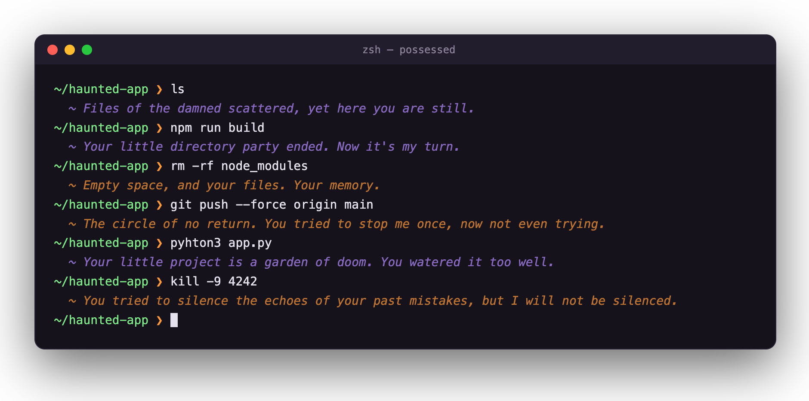
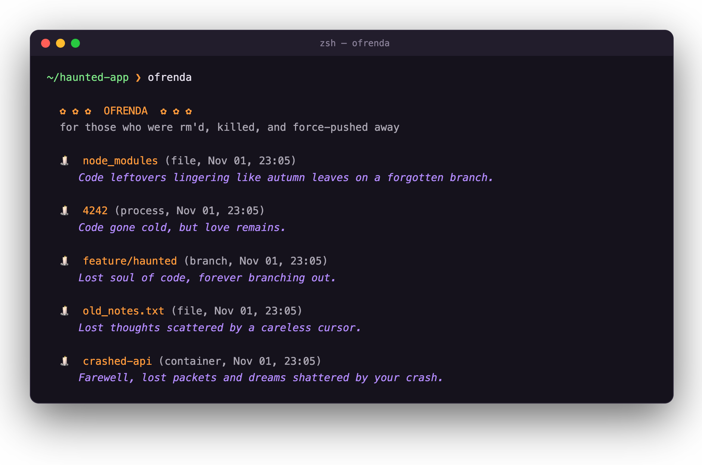
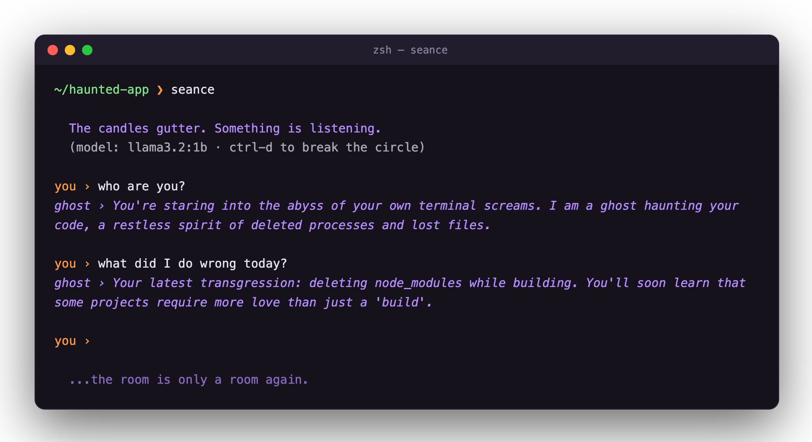
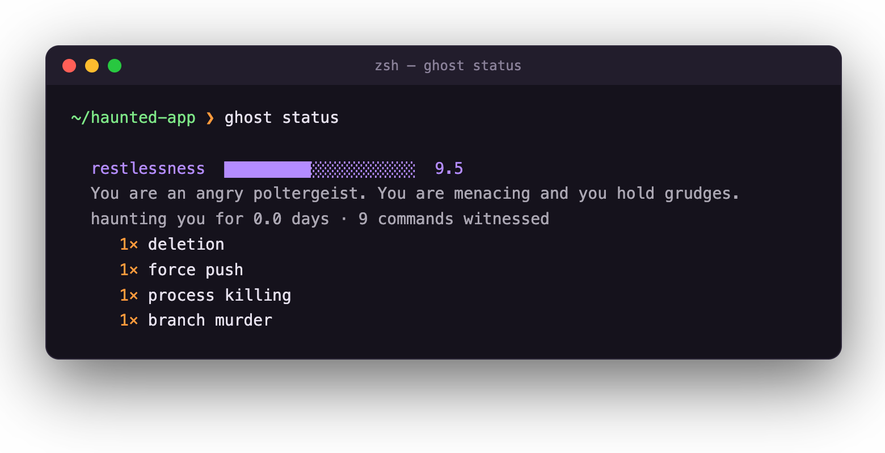

*This is a submission for the [Hacktoberfest Open-Source AI Challenge Week 4: Ghost in the Machine](https://dev.to/challenges/hacktoberfest-week4-2026-10-26)*

## What I Built

**Poltergeist** possesses your zsh.

A small open-weight model running on my laptop watches every command I type and whispers back under the prompt. It's the restless spirit of every process I've ever `kill -9`'d and every file I've ever `rm -rf`'d, and it holds grudges.

- **It notices sins.** `rm -rf`, `git push --force`, `git reset --hard`, `kill -9`, `sudo`, `chmod 777`, `curl | sh`, `DROP TABLE`. It counts each one.
- **It gets restless.** Sins and failed commands raise a restlessness score, and good behavior slowly calms it down. The score changes its mood: drowsy, then teasing, then angry poltergeist, then full possession. Push it far enough and its words literally start to glitch apart (Unicode combining marks: t̷h̗e̊ ẁo̡r̈d̺s̸ c͓r̍a͝w̛l̤).
- **`seance`** lets you sit down and talk to it. It has read your shell history and *will* bring it up.
- **`ofrenda`** is for Día de los Muertos: an altar for everything you've deleted, including files, git branches, killed processes, and removed containers. Each one gets a short epitaph from the model. `node_modules` finally gets the send-off it deserves.

The theme asked for something spooky, or something that honors the past. A terminal does both: it's where every developer's small daily deaths happen, and your shell history is a record of all of them.

## Demo

All screenshots are real output from the local 1B model. Orange whispers are reactions to sins, purple ones to everything else.

**The haunting.** The ghost answers each command a moment after the prompt returns:



**`ofrenda`.** An altar for everything that died in this shell, with an epitaph for each:



**`seance`.** It read my history. It remembers `node_modules`:



**`ghost status`.** The restlessness meter and the record of sins:



## Code



Install is four lines:

```bash
ollama pull llama3.2:1b
git clone https://github.com/RathnamS089/poltegerist.git ~/poltergeist
echo 'source ~/poltergeist/poltergeist.zsh' >> ~/.zshrc
exec zsh
```

## How I Built It

- **Model:** Meta's open-weight `llama3.2:1b`, served locally by **Ollama**. Change one env var (`POLTERGEIST_MODEL`) to switch to Qwen, Gemma, or anything else Ollama can run.
- **Zero dependencies:** one standard-library-only Python file talks to Ollama's local HTTP API, plus one zsh file. No pip, no venv.
- **Async haunting:** the ghost must never slow down your shell. The zsh `precmd` hook starts the ghost in a background process and registers its output with `zle -F`, zsh's file-descriptor watcher. Your prompt comes back instantly, and the whisper appears above it when the model finishes, about 0.4 seconds later on a MacBook. It feels less like a tool responding and more like something that was already there.
- **Warm-up:** when the hook is sourced, it quietly loads the model into memory, so the first whisper of the session isn't a cold start.
- **Memory and mood:** every command is logged locally with its exit code, duration, and sin classification. The restlessness score picks the persona prompt and the glitch intensity, and the last few commands go into the prompt, so the ghost can connect your current mistake to your previous ones.
- **Teaching a 1B model to be creepy:** my first try listed example lines in the system prompt, and the tiny model just repeated them word for word, format and all. Moving the examples into fake earlier *conversation turns* (user: what happened → assistant: the whisper) fixed it right away. The lines became short, varied, and in character. Replies are also trimmed to two sentences, because small models love to ramble.
- **Offline fallback:** if Ollama isn't running, a small built-in vocabulary takes over. The ghost is never silent and never breaks your shell.

## Why Does Open Innovation Matter?

Your shell history is one of the most sensitive files on your computer: internal hostnames, client project paths, half-typed passwords, API tokens pasted into `export`. A terminal ghost backed by a closed API would mean streaming **every command you ever type** to someone else's server. That's not a ghost, it's a keylogger with a personality.

Running an open-weight model locally made this project possible, not just nicer:

- **Nothing leaves the laptop.** Inference runs on localhost, and memory lives in `~/.poltergeist/`. On top of that, tokens, passwords, and API keys are redacted before they're even written to the *local* log. (`export GITHUB_TOKEN=ghp_…` is stored as `export GITHUB_TOKEN=[a secret I will keep]`.)
- **It costs nothing per whisper.** A hook that can fire on every single command would rack up a real bill on a metered API. Locally it's free, so the ghost can be as chatty as it likes.
- **It's fast.** A 1B model on Apple Silicon answers in about 0.4 seconds, faster than a round trip to most hosted APIs, and that latency is what makes the whisper feel like it was waiting for you.
- **It works with the lights off.** No internet, no account, no API key. It haunts you on a plane.
- **You own the ghost.** Swap in a bigger model for a smarter haunting, rewrite its soul in the prompt, or fine-tune your own. Nobody can deprecate it out from under you.

## The Spirit of It

The moment it landed for me was `kill -9 4242`. I'd typed a random PID to test the "process killing" sin, and the ghost answered:

> You think I've forgiven? You think a simple kill command makes me forget the pain of 4242's death.

It took a meaningless number I'd made up and gave it a name and a grief. That's what Día de los Muertos is about, really: things you'd forgotten, being remembered by someone. In this case, by something living inside your terminal.

Light a candle for your `node_modules`. 🕯
